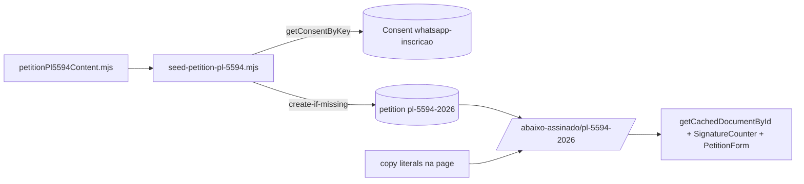

# Impl: Abaixo-assinado do PL 5594/2026 — transparência dos presidenciáveis (S48)

Status: aprovado
Atualizado em: 2026-10-21
Issue: #1443
Intenção: docs/plans/abaixo-assinado-pl-5594-2026.md
Appetite restante: herdado — ~0,5 dia eng, sem corte

## Leitura da intenção

- **Outcome:** a petição `pl-5594-2026` existe `enabled`, com título/subtítulo/corpo/consent, página 200 em `/abaixo-assinado/pl-5594-2026`, assinável e compartilhável, com contador e SEO atual.
- **O que NÃO negociar:** sem cadastro paralelo a `Contact`; sem acusar crime nem prometer aprovação; sem Consent novo (reusar `whatsapp-inscricao`); sem migration/collection nova; `id` é a URL pública e não muda; sem PII em log.
- **O que reavaliar:** a hipótese "conteúdo criado no admin" não é repetível/auditável — vira seed versionado; "sem código novo" vira seed + copy + testes (sem schema).

## Abordagem recomendada

**Opções consideradas:** A) criar a petição só no admin; B) migration de dados; C) seed idempotente versionado + ajuste de copy + testes unitários.  
**Recomendação:** C — o conteúdo nasce no repo, é revisável/testável, reproduzível em worktree/staging/produção e não toca schema.  
**Rejeitadas:** A porque não é repetível/auditável e some do repo; B porque a intenção proíbe migration e conteúdo editorial não pertence a migration.

### Componentes / mudanças

- **`scripts/lib/petitionPl5594Content.mjs`**: literais (id, título, subtítulo, `form.title` "Assine o abaixo-assinado"/`form.subtitle` "Preencha seus dados para apoiar o PL 5594/2026.", consent key), 5 blocos HTML e links oficiais; fonte única para seed e testes.
- **`scripts/seed-petition-pl-5594.mjs`**: dry-run por padrão; `--apply`; create-if-missing por `id`; consent via `getConsentByKey` (fail-closed); HTML→Lexical com `editorConfigFactory.default` + JSDOM (padrão de `seed-posts.mjs`).
- **`package.json`**: `"seed:petition-pl-5594": "cross-env NODE_OPTIONS=\"--no-deprecation --import=tsx/esm --import=./scripts/seed-loader.mjs\" node scripts/seed-petition-pl-5594.mjs"`.
- **`src/app/(frontend)/abaixo-assinado/[id]/page.tsx:204-213`**: só copy (D2); canonical/OG/JSON-LD existentes, sem SEO novo.
- **Testes**: novo `tests/unit/petitionPl5594Content.unit.spec.ts`; ajuste de `tests/unit/petition-page-layout.unit.spec.ts`.
- **Changelog:** `docs/changelog/2026-10-22-s48-peticao-pl-5594.md` (copy global + passo de seed em produção).
- **Migration:** nenhuma; nenhuma collection/field/access alterado.
- **Access / Consent:** access inalterado; Consent existente `whatsapp-inscricao` resolvido por key (`overrideAccess` intencional), nunca por id hardcoded; ausência → seed aborta.
- **UI:** Impeccable A — nenhuma UI nova; reusa page, `PetitionForm` e `SignatureCounter`; sem shape/craft/critique.

### Dados → forma

- Contador absoluto já existente (`SignatureCounter` + `getSignatureCount`); sem percentual, ranking ou meta. Nenhuma forma nova.

## Decisões de engenharia

**D1 — Provisionamento do conteúdo.**  
Opções: A) criar só no admin; B) migration de dados; C) seed dedicado versionado, dry-run e create-if-missing.  
Recomendação: C — idempotente por `id`, auditável, testável em worktree/staging; dry-run default, `--apply`, guards `PETITION_SEED_CONFIRM=1` + `assertEnvironmentDatabaseTarget`, npm script `seed:petition-pl-5594`; se existir, reporta `_status`/`enabled` e não sobrescreve (admin vira dono).  
Rejeitadas: A porque não é repetível nem revisável no repo; B porque viola a intenção e mistura editorial com schema; upsert/sobrescrita porque apagaria ajuste feito no admin.

**D2 — Copy do bloco do formulário.**  
Opções: A) novos campos no schema; B) editar as 3 strings hardcoded; C) manter.  
Recomendação: B — headline "Sua assinatura fortalece esta mobilização."; parágrafo "Os dados serão usados para registrar sua participação e a comunicação de conteúdos relacionados."; eyebrow "Participe da mobilização" intacto. Afeta as 3 petições existentes, autorizado na intenção; registrar no changelog.  
Rejeitadas: A porque exige migration/field para copy e não há demanda de admin; C porque "campanha"/"trabalhadores" contradizem os literais de produto.

**D3 — Corpo em 5 blocos.**  
Opções: A) Lexical JSON à mão; B) HTML versionado convertido por `convertHTMLToLexical`; C) texto corrido.  
Recomendação: B — HTML legível/revisável, reusa o padrão de `seed-posts.mjs`; h2 nos 5 blocos (o que é; por que agora; o que o PL não faz; o pedido; links oficiais), listas e links para ficha/inteiro teor.  
Rejeitadas: A porque é verboso e frágil de revisar; C porque perde h2/listas/links exigidos.  
Fatos: ementa oficial (transparência patrimonial, fiscal e financeira; altera a Lei 9.504/1997); autorização expressa no registro (Pres/VP); 5 exercícios fiscais anteriores de IR; dados bancários/financeiros; registros telefônicos e de conexão/acesso sem o conteúdo das comunicações; acesso exclusivo por autoridades competentes (fiscalização eleitoral, verificação patrimonial, apuração de indícios concretos); auditoria (responsável/finalidade/data/categorias); confidencialidade e vedação de finalidade estranha; conteúdo só com ordem judicial; LGPD (Art. 7); Justiça Eleitoral divulga o autorizado resguardando terceiros (Art. 3 §2º); complementação com contraditório (Art. 5); vigência após adaptação (Art. 8).  
Guardrails: motivação 18/10 cita o desafio de Lula a Flávio Bolsonaro e o protocolo de Solla em 19/10 (sem tramitação posterior em 21/10), sem afirmar crime/ilícito/recusa não comprovada; pedido de tramitação/aprovação sem prometer resultado; `form.title`/`form.subtitle` são copy do seed (a intenção não os fixa).

**D4 — Testes.**  
Opções: A) unit do conteúdo + pin da copy; B) acrescentar int; C) e2e novo.  
Recomendação: A — invariantes puros (id/título/subtítulo/consent key/5 blocos/fatos/links; ausência de "crime", "ilícito", "corrupção", "desvio", "será aprovado") + pin da copy com whitespace normalizado (JSX quebra linha); fluxo de assinatura intocado.  
Rejeitadas: B porque o write path/transação não muda e o int existente já cobre; C porque não há interação nova, a suíte não tem e2e de petição e o custo/flakiness não se paga.

**D5 — Aplicação em produção e cache.**  
Opções: A) deploy aplica o seed; B) passo manual pós-merge documentado; C) não aplicar.  
Recomendação: B — no checkout do homeserver (deps de dev, como nos demais seeds), com o env do stack carregado: `TEQO_ENV=production PETITION_SEED_CONFIRM=1 pnpm seed:petition-pl-5594 --apply`; registrar no changelog/PR.  
Rejeitadas: A porque deploy não deve publicar conteúdo editorial e o guard exige intenção explícita; C porque o aceite exige a página em produção.  
Limitação: o seed roda fora do processo do Next e não busta `document_petition:<id>`; `findByID` lança 404 (não há entrada negativa no `unstable_cache`), mas uma visita anterior ao slug pode ter cacheado a resposta 404 na rota. Após o seed, reiniciar/redeployar o container (ou salvar a petição uma vez no admin) antes de divulgar; sem endpoint novo.

**D6 — Escopo negativo.**  
Opções: A) incluir agora; B) cortar e registrar.  
Recomendação: B — e2e novo, CTA home/footer (S47), OG nova, consent novo e conserto do escape do JSON-LD ficam fora; a dívida do JSON-LD (`page.tsx:150-153`) vai para o changelog/issue.  
Rejeitadas: A porque estoura o appetite e mistura concerns.

## Fases verificáveis

1. **Fase 1 — conteúdo + seed (tracer, ~0,25 dia):** content module + seed + npm script; dry-run no worktree resolve consent e mostra o plano; `--apply` cria `pl-5594-2026` `enabled`/`published`; segunda execução é no-op.
2. **Fase 2 — copy (UI, ~0,05 dia):** editar as 3 strings; nenhum componente novo; conferir `PetitionForm` data-driven.
3. **Fase 3 — testes (~0,1 dia):** unit novo e pin da copy; rodar os dois specs.
4. **Fase 4 — verificação local (~0,05 dia):** com o DB do worktree, `GET /abaixo-assinado/pl-5594-2026` → 200; conferir título, 5 h2, links oficiais, contador e consent; uma assinatura manual de fumaça com dados fictícios (sem teste commitado). Sem e2e novo: o fluxo não mudou e a suíte não tem precedente de petição.
5. **Fase 5 — gates e entrega (~0,05 dia):** `pnpm gate:fast`, changelog, PR com o passo de produção; `pnpm push`.

## Rabbit holes / Não escopo (engenharia)

- Não editar schema/collection/Consent; não criar migration; não "consertar" o SEO existente nem o escape do JSON-LD neste PR.
- Não transformar o seed em upsert, importador genérico de petições ou runner de deploy.
- Não criar e2e/listing/meta de assinaturas/ranking; não adicionar imagem OG ou CTA na home (S47).
- Não duplicar leitura de petição: reusar `getCachedDocumentById`, `getSignatureCount`, `getConsentByKey`.

## Débitos da sessão (triage)

- **Registrado:** escape de `<` no JSON-LD da petição — Issue #1447 (`S48-FOLLOWUP-JSONLD`, plano `docs/plans/json-ld-escape-peticao-impl.md`).
- **Deferido com gatilho:** int test do write path do seed (HTML→Lexical + `_status`/`enabled`/`form.consent`) — reabrir na próxima edição de conteúdo/seed ou upgrade do Payload no `create`; hoje os invariantes do conteúdo estão em unit e o create foi provado em DB temporário.
- **Descartado:** rename do npm script (`seed:face-*` é precedente) e reparo gramatical de literal fixado pela intenção.

## Riscos e mitigação

- **`id` é URL pública e PK:** definido uma vez no seed; create-if-missing nunca altera; revisão de conteúdo não mexe no id.
- **Consent ausente/errado:** resolução por key fail-closed; sem id hardcoded; dry-run mostra o alvo antes de escrever.
- **Seed rodado no ambiente errado:** `assertWriteConfirm` (`PETITION_SEED_CONFIRM`) + `assertEnvironmentDatabaseTarget` (`TEQO_ENV` casando `teqo_1313`/`teqo_staging`); write só com `--apply`.
- **Cache negativo do 404:** documentado em D5; operador reinicia/redeploya ou salva no admin após o seed.
- **Copy afeta 3 petições:** mudança intencional e autorizada; changelog registra; rollback é reverter o commit.
- **Divergência editorial pós-seed:** o seed não sobrescreve; o admin é dono; testes pinam o conteúdo versionado, não o DB.

## Aceite de engenharia

- [ ] Petição `pl-5594-2026` criada `enabled`/`published`, consent `whatsapp-inscricao` resolvido por key, sem migration/collection nova.
- [ ] Corpo com 5 blocos e fatos oficiais; sem acusação de crime e sem promessa de aprovação.
- [ ] Copy nova na page; eyebrow intacto; `PetitionForm` continua data-driven.
- [ ] Seed dry-run por padrão, create-if-missing, guards e npm script; segunda execução no-op.
- [ ] Testes de domínio: unit novo/atualizado verde; sem int porque o write path não muda; `pnpm gate:fast` limpo.
- [ ] Verificação local: página 200, corpo/consent/contador renderizados, assinatura de fumaça OK.
- [ ] Changelog + passo de seed em produção documentados no PR.
- [ ] Invariantes AGENTS/engineering-standards: sem PII em log; access/LGPD inalterados; sem migration.
- [ ] Aceite de produto da intenção ainda coberto.

## Self-score decision-quality

5/5 — todas as decisões caras têm rejeitadas (D1–D6); appetite herdado sem corte; rabbit holes nomeados; depth check reusa `getConsentByKey`, `getCachedDocumentById`, `getSignatureCount`, `seed-loader` e o padrão de `seed-posts`; o outcome de produto permanece intacto.
