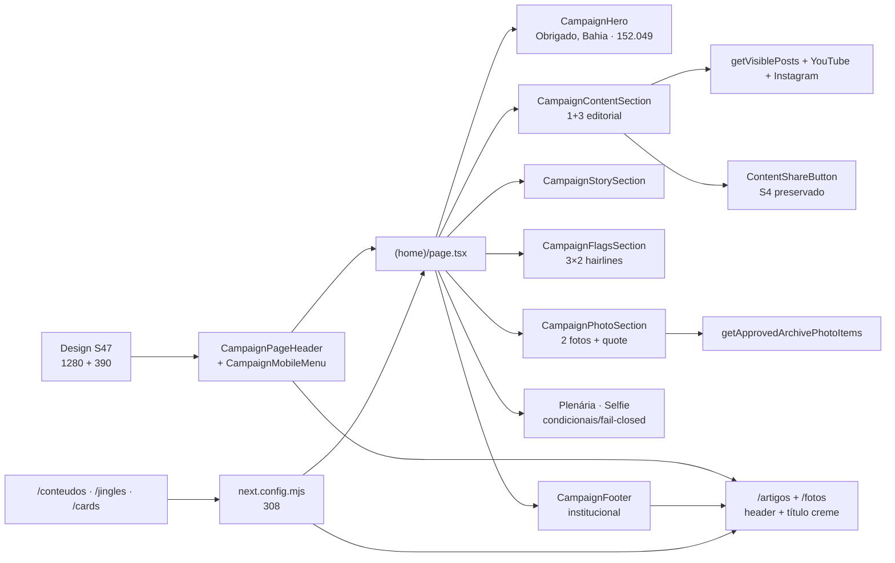

# Impl: Site público pós-eleição — retirar a propaganda e agradecer os 152.049 votos (S47)

Status: aprovado (modo --auto)
Atualizado em: 2026-10-21
Issue: #1442
Intenção: docs/plans/site-pos-eleicao-agradecimento.md
Design UI: docs/plans/site-pos-eleicao-agradecimento-ui-design.html
Appetite restante: herdado (~1–2 dias eng; corte explícito: sem redesenho das páginas internas além do título/shell, sem migration, sem asset novo)
Self-score decision-quality: 5/5 — as 8 decisões caras têm opções e rejeitadas, o escopo cabe no appetite, os rabbit holes estão nomeados, os shells existentes são reusados e o aceite de produto permanece o norte.

## Leitura da intenção

- **Outcome:** o site público deixa de ser peça de campanha — nenhuma superfície pública exibe 1313 como número eleitoral, pedido de voto, “candidato”, “propaganda eleitoral” ou CNPJ de campanha; a home abre com “Obrigado, Bahia — 152.049 votos de confiança” e segue como casa institucional do mandato (notícias, trajetória, bandeiras, fotos e selfie), com rodapé institucional.
- **O que NÃO negociar:**
  - O número **152.049** é o literal TSE (totalização de 05/10/2026), não percentual, ranking ou dashboard.
  - O logo visível é o lockup de nome (`jorge-solla-positivo/negativo`), nunca `marca-*-completa`/`numero-*`.
  - Sem migration, sem Consent novo, sem PII nova, sem apagar dados do CMS.
  - `/fotos`, `/artigos`, `/privacidade` e o acervo de fala continuam; `/potencial` e a Plenária ficam até 25/10 e saem depois (decisão de produto já assumida).
  - O domínio/canonical atual continua até OPS131; nada de `/campanha`.
  - O design hi-fi aprovado é o alvo do port.
- **O que reavaliar (hipóteses da intenção que o código desmente):**
  - O board atual é 1+4 com carrossel mobile e feeds; o design pede 1+3 editorial e **sem carrossel obrigatório**.
  - O `/artigos` atual usa hero em vermelho com imagem do global `home`; o design pede título compacto em creme — a imagem passa a ser OG, não hero.
  - O `/fotos` atual tem header vermelho e `ArchivePhotoHero` de campanha; o design pede header positivo em creme e título compacto.
  - O `CampaignFooter` hoje é condicional (Jingles/Conteúdos/Fotos) e eleitoral; vira institucional com Fotos sempre visível.
  - O vídeo da trajetória é um Short 9:16 real; o 16:10 do gate é composição, não mídia existente.

## Abordagem recomendada

**Opções consideradas:** A) editar os donos existentes (header/footer/hero/board/story) e portar o design na home + shell, com redirects das rotas de campanha; B) criar um “site do mandato” paralelo (novo shell/novas rotas); C) manter as páginas de campanha publicadas, só escondendo-as do menu.

**Recomendação:** **A** — é o único caminho que cabe em ~1,5 dia: reusa `CampaignHero`, `CampaignContentSection`, `CampaignStorySection`, `CampaignFooter`, `CampaignPageHeader`, `CampaignLogoLink`, `ShareLinkHomeSection` e `SelfieSearchHomeSection`, troca somente a composição/copy e remove as superfícies de campanha. Evita collection, migration e um segundo design system.

**Rejeitadas:** **B** porque duplica shell, cria uma segunda navegação e estoura o appetite (o site institucional completo é PUB2); **C** porque mantém as rotas acessíveis/indexáveis e o código de campanha vivo, falhando o aceite “saem do ar”.

### Ordem final da home (alvo do port)

| #   | Seção                  | Dono no código                          | Conteúdo/observação                                                                                                                                              |
| --- | ---------------------- | --------------------------------------- | ---------------------------------------------------------------------------------------------------------------------------------------------------------------- |
| 1   | Header                 | `CampaignPageHeader` (`variant="home"`) | Lockup negativo sobre vermelho; nav desktop **Mandato · Bandeiras · Fotos**; menu mobile acessível                                                               |
| 2   | Hero de agradecimento  | `CampaignHero` (reescrito)              | Eyebrow **Obrigado, Bahia**; h1 **152.049 / votos de confiança**; copy do design; CTA **Acompanhe o mandato** → `/artigos`; identidade; retrato `JOA00162.webp`  |
| 3   | Plenária (condicional) | `ShareLinkHomeSection`                  | Mantida **logo após o hero** até 25/10; ausente por CMS/kill switch; não é CTA concorrente                                                                       |
| 4   | Board editorial        | `CampaignContentSection` (reescrito)    | **1+3** em creme com hairlines; 4 itens (posts + YouTube + Instagram); sem carrossel mobile; estado vazio “Ainda não há publicações”                             |
| 5   | Trajetória             | `CampaignStorySection`                  | **Nossa história / Saúde pública como escolha de vida**; Short 9:16 existente; CTA “Assistir à trajetória”                                                       |
| 6   | Bandeiras              | `CampaignFlagsSection` (novo)           | **Bandeiras do mandato / Compromissos que orientam o trabalho**; 3×2 desktop, 1×6 mobile, hairlines, sem cards flutuantes                                        |
| 7   | Fotos                  | `CampaignPhotoSection` (novo)           | **Perto da Bahia / O mandato em fotos**; 2 fotos aprovadas + tile “Trabalho presente, memória viva.”; link `/fotos`; estado vazio “O álbum está sendo preparado” |
| 8   | Selfie (condicional)   | `SelfieSearchHomeSection`               | Mantida após as fotos; só com álbum publicado + flag + foto aprovada (C243)                                                                                      |
| 9   | Rodapé                 | `CampaignFooter` (reescrito)            | Institucional: lockup, cargo/partido/estado, Navegue (Artigos · Fotos · Privacidade), Redes, linha legal; sem CTA/CNPJ/turno                                     |

O design mostra 1–2–4–5–6–7–9; as seções 3 e 8 são exceções vivas do produto, condicionais e fail-closed, e não alteram a dobra.

### Contrato visual (resumo do gate)

- **Tokens/fontes:** `--pt-red #a21c1c`, `--pt-red-dark #47130e`, `--pt-yellow #ffe607`, `--campaign-cream #fff8f2`, `--campaign-band #ebe9e9`, `--campaign-line rgb(0 0 0 / 12%)`, `--campaign-muted #6c615e`; Exo 2 (display) e Arimo (texto) já carregadas em `fonts.ts`/`styles.css`. Nenhuma fonte/paleta nova.
- **Geometria:** conteúdo máximo **1152px**; header desktop **88px**, mobile **74px**; hero desktop mínimo **668px**, mobile **760px**; um único CTA primário na dobra; board **7/12 + 5/12** no desktop e coluna única no mobile; bandeiras 3×2; fotos 530px no desktop; cantos 8–12px; sem sombra na página real.
- **Estados:** board vazio “Ainda não há publicações”; álbum vazio “O álbum está sendo preparado”; nunca buraco silencioso.
- **A11y:** foco C243 (3px amarelo + separador azul-escuro `#184e92`) em superfícies claras; amarelo visível no escuro; menu mobile abre/fecha no trigger, fecha no X/link/fora/Escape, foca o primeiro link ao abrir e devolve o foco ao trigger; alt contextual; `prefers-reduced-motion` remove transições.
- **Proibido na superfície:** 1313, pedido de voto, “candidato”, “propaganda eleitoral”, CNPJ eleitoral, data/turno, “Quero apoiar”, newsletter/captação, Central, cards eleitorais, jingles/rádio, `marca-*-completa`, `numero-*`, ranking/percentual/dashboard.

### Componentes / mudanças

- **`CampaignPageHeader`** (`src/components/CampaignPageHeader.tsx`): dono único do topo público; ganha `variant: 'home' | 'internal'`, `current?: 'artigos' | 'fotos'` e mantém `badge?` (share link). Home = fundo vermelho/lockup negativo/nav branca; interno = creme/lockup positivo/nav vermelha. Renderiza o logo no servidor e delega só o disclosure mobile ao cliente.
- **`CampaignMobileMenu`** (`src/components/CampaignMobileMenu.tsx`, novo, client): disclosure acessível do menu mobile; sem dialog/trap (não é modal), com `aria-expanded`, `aria-controls`, `hidden`, foco inicial/retorno e fechamento por Escape/clique fora/link.
- **`CampaignLogoLink`** (`src/components/CampaignLogoLink.tsx`): continua dono do crop do lockup; ganha `tone: 'negative' | 'positive'` e `priority?`; corrige `aria-label` para “Início — Jorge Solla” e alt “Jorge Solla — Deputado Federal”; positiva usa janela 160×58 desktop/128×46 mobile (img 209px; offsets −24,8/−32,6).
- **`CampaignFooter`** (`src/components/CampaignFooter.tsx`): vira o rodapé institucional; perde `showJingles/showConteudos/showFotos`; `current?: 'artigos' | 'fotos'`; Fotos sempre visível (a página do álbum tem estado vazio honesto); sem `Quero apoiar`, CNPJ, propaganda ou turno.
- **`CampaignHero`** (`src/components/CampaignHero.tsx`): mesmo dono, conteúdo novo; constante local `THANK_YOU_VOTE_TOTAL = '152.049'`; h1 com `aria-label` completo; CTA único `/artigos`; retrato e composição do gate; nenhum “Quero apoiar”/1313.
- **`CampaignContentSection`** (`src/components/CampaignContentSection.tsx`): mantém o pipeline de posts + YouTube + Instagram e o share (S2/S3/S4); reescreve o layout para 1+3, remove o carrossel mobile e passa a renderizar o estado vazio em vez de `null`; limite 4.
- **`CampaignContentCard`** (`src/components/CampaignContentCard.tsx`): ganha `variant: 'featured' | 'compact'`; compact é texto (sem capa) com kicker vermelho, título e “Ler notícia/abrir”; o share continua como ação secundária acessível.
- **`CampaignStorySection`** (`src/components/CampaignStorySection.tsx`): copy do design; mantém o iframe `youtube-nocookie` 9:16 existente.
- **`CampaignFlagsSection`** (`src/components/CampaignFlagsSection.tsx`, novo): seis bandeiras do design em `<ol>` com hairlines; substitui `CampaignFlagCard`/`CampaignCarousel` e a copy eleitoral.
- **`CampaignPhotoSection`** (`src/components/CampaignPhotoSection.tsx`, novo): recebe `ArchivePhotoPublicItem[]`; 2 fotos + quote tile; empty state; usa `thumbnailPath` (proxy privado) e alt curado.
- **`(home)/page.tsx`**: nova composição; uma leitura de `getApprovedArchivePhotoItems()` serve fotos + gate da selfie (sem o matching facial, que só o álbum precisa); mantém Plenária/selfie condicionais; remove proof/problem/cards/sound/content-pieces/newsletter.
- **`publicSite`** (`src/lib/publicSite.ts`, novo): caminhos, links sociais oficiais e receita de foco compartilhados por header/footer/board; evita strings duplicadas.
- **Migration:** **nenhuma**. Nenhuma collection/global/field é alterado.
- **Access / Consent:** nenhum novo. Remove-se o caminho da newsletter (action/schema/helper/chave `campanha-novidades`); a linha `Consent` e as subscriptions existentes **não** são apagadas.
- **UI:** Impeccable **C**; shape→craft→critique→polish com o `designer`; shells existentes; sem novo design system.

### Arquivos por área

**Shell e páginas internas**

| Arquivo                                              | Ação              | Detalhe                                                                                                                                                                                                       |
| ---------------------------------------------------- | ----------------- | ------------------------------------------------------------------------------------------------------------------------------------------------------------------------------------------------------------- |
| `src/lib/publicSite.ts`                              | criar             | `PUBLIC_PATHS`, `PUBLIC_SOCIAL_LINKS`, `PUBLIC_FOCUS`; usado por header/footer/board                                                                                                                          |
| `src/components/CampaignLogoLink.tsx`                | editar            | `tone`, `priority`, crop positivo/negativo, alt/aria sem 1313                                                                                                                                                 |
| `src/components/CampaignPageHeader.tsx`              | reescrever        | variantes home/internal, nav, current, badge; sem 1313 no alt/aria                                                                                                                                            |
| `src/components/CampaignMobileMenu.tsx`              | criar (client)    | disclosure a11y completo                                                                                                                                                                                      |
| `src/components/CampaignFooter.tsx`                  | reescrever        | institucional, sem flags, `current`, Fotos sempre                                                                                                                                                             |
| `src/app/(frontend)/artigos/layout.tsx`              | editar            | `data-theme="campaign-site"`, `CampaignPageHeader current="artigos"`, `CampaignFooter current="artigos"`; sai `SiteHeader`/`Footer`                                                                           |
| `src/app/(frontend)/artigos/page.tsx`                | editar            | título creme “Mandato em movimento / Artigos e notícias”; `generateMetadata` com canonical `/artigos` e OG de `home.image`; manter grade de últimas notícias; remover hero/imagem/CTA                         |
| `src/app/(frontend)/fotos/page.tsx`                  | editar            | header compartilhado; título creme “Memória do mandato / Fotos”; remover `ArchivePhotoHero`, flags de rodapé e `hasPublishedJingles`/`hasPublishedContentPieces`; manter busca/filtros/grade/lightbox/removal |
| `src/app/(frontend)/fotos/encontre/page.tsx`         | editar            | header compartilhado; h1 “Encontre você nas fotos” + descrição; remover flags/`hasPublishedContentPieces`; título sem 1313                                                                                    |
| `src/app/(frontend)/fotos/[id]/midia/route.ts`       | editar comentário | nome legível vem de `downloadFilename`; atualizar o literal do comentário                                                                                                                                     |
| `src/lib/archivePhotoPublicCatalog.ts`               | editar            | `DOWNLOAD_PREFIX = 'jorge-solla-foto'`                                                                                                                                                                        |
| `src/components/fotos/ArchivePhotoPageHeader.tsx`    | deletar           | substituído pelo header compartilhado                                                                                                                                                                         |
| `src/components/fotos/ArchivePhotoHero.tsx`          | deletar           | substituído pelo título creme                                                                                                                                                                                 |
| `src/app/(frontend)/(home)/potencial/page.tsx`       | editar            | header/footer novos; remover flags de descoberta; manter estúdio até 25/10                                                                                                                                    |
| `src/components/shareLink/ShareLinkAnnouncement.tsx` | editar            | remover props `showJingles/showFotos`; header/footer novos                                                                                                                                                    |
| `src/app/(frontend)/[type]/page.tsx`                 | editar            | remover reads de jingles/fotos e props do anúncio                                                                                                                                                             |
| `src/utilities/seo.ts`                               | editar            | `SITE_METADATA_DEFAULTS.description` → “Notícias, o mandato e a atuação do deputado Jorge Solla pela Bahia.”                                                                                                  |
| `next.config.mjs`                                    | editar            | `async redirects()` com 308                                                                                                                                                                                   |

**Home**

| Arquivo                                             | Ação                  | Detalhe                                                                                                                       |
| --------------------------------------------------- | --------------------- | ----------------------------------------------------------------------------------------------------------------------------- |
| `src/app/(frontend)/(home)/page.tsx`                | reescrever composição | header, hero, plenária, board, story, flags, photos, selfie, footer; sem proof/problem/cards/sound/content-pieces/newsletter  |
| `src/components/CampaignHero.tsx`                   | reescrever            | hero de agradecimento; literal 152.049; CTA `/artigos`; retrato                                                               |
| `src/components/CampaignContentSection.tsx`         | reescrever            | 1+3, 4 itens, empty state, links fixos YouTube/Instagram, feeds/share preservados                                             |
| `src/components/CampaignContentCard.tsx`            | editar                | variante compacta sem capa; share secundário                                                                                  |
| `src/components/CampaignContentCarousel.tsx`        | deletar               | design sem carrossel obrigatório                                                                                              |
| `src/components/CampaignStorySection.tsx`           | editar copy           | “Saúde pública como escolha de vida” / “Assistir à trajetória”                                                                |
| `src/components/CampaignFlagsSection.tsx`           | criar                 | seis bandeiras do design; `id="bandeiras"`                                                                                    |
| `src/components/CampaignPhotoSection.tsx`           | criar                 | 2 fotos + quote; empty state                                                                                                  |
| `src/components/fotos/SelfieSearchHomeSection.tsx`  | manter                | posição após fotos; gate C243 intacto                                                                                         |
| `src/components/shareLink/ShareLinkHomeSection.tsx` | manter                | posição após hero; S44 intacto                                                                                                |
| `src/app/(frontend)/(home)/layout.tsx`              | manter                | scroll container + MetaPixel PageView; atualizar comentário                                                                   |
| `src/app/(frontend)/styles.css`                     | limpar                | remover blocos mortos de hero/proof/problem/flags/sound/cards/newsletter; manter tokens e `campaign-section-*` compartilhados |
| `src/components/CampaignHashScroll.tsx`             | comentário            | `#novidades` → `#bandeiras`                                                                                                   |
| `src/components/RefreshRouteOnSave.tsx`             | comentário            | referência ao anchor antigo                                                                                                   |

**Rotas, newsletter e órfãos**

| Arquivo                                                                                                                    | Ação                         | Detalhe                                                                                                                                        |
| -------------------------------------------------------------------------------------------------------------------------- | ---------------------------- | ---------------------------------------------------------------------------------------------------------------------------------------------- |
| `src/app/(frontend)/conteudos/**`                                                                                          | deletar                      | redirect 308 para `/artigos`                                                                                                                   |
| `src/app/(frontend)/jingles/**`                                                                                            | deletar                      | redirect 308 para `/`                                                                                                                          |
| `src/app/(frontend)/(home)/cards/**`                                                                                       | deletar                      | redirect 308 para `/`                                                                                                                          |
| `src/app/(frontend)/(home)/CampaignCardsSection.tsx`                                                                       | deletar                      | seção de cards eleitorais                                                                                                                      |
| `src/components/CampaignCarousel.tsx`, `CampaignProblemCard.tsx`, `CampaignFlagCard.tsx`                                   | deletar                      | sem consumidores após a home nova                                                                                                              |
| `src/components/conteudos/**`                                                                                              | deletar                      | UI pública da Central; CMS/`/campanha` ficam                                                                                                   |
| `src/components/jingles/**`, `src/lib/radio.ts`, `src/lib/jingle.ts`, `src/utilities/jingleReads.ts`                       | deletar                      | UI/reads públicos de jingles/rádio; collection `Jingle` fica                                                                                   |
| `src/lib/contentPieceHomeSelection.ts`, `src/lib/contentPieceShare.ts`, `src/utilities/content/contentPieceThemeSearch.ts` | deletar se órfãos            | rodar `git grep -w` antes; `contentPieceReads` mantém só o slug read usado por `api/content-events`                                            |
| `src/components/cards/**` (UI do estúdio)                                                                                  | deletar somente a UI pública | **manter** `cardCanvas.ts`/`cardCutout.ts` (selfie e story canvas) e `lib/cardModels`/`cardDownloadCounts`/`contentEvents` (dashboard interno) |
| `src/components/CampaignNewsletterForm.tsx`, `src/app/(frontend)/(home)/CampaignNewsletterSection.tsx`                     | deletar                      | captura de campanha                                                                                                                            |
| `src/app/(frontend)/actions/submitCampaignNewsletter.ts`, `src/lib/schemas/campaignNewsletter.ts`                          | deletar                      | action/schema exclusivos                                                                                                                       |
| `src/lib/campaignConsentKeys.ts`, `src/utilities/campaignConsent.ts`                                                       | editar                       | remover chave/helper `campanha-novidades`; demais Consent intactos                                                                             |
| `src/app/(frontend)/api/content-events/route.ts`                                                                           | manter                       | eventos históricos; sem UI nova                                                                                                                |
| `src/collections/**`, `src/globals/**`, `src/app/(campaign)/**`                                                            | não tocar                    | sem migration, sem PII, sem deleção de CMS                                                                                                     |

**Testes, scripts e docs**

| Arquivo                                                                                                                                                           | Ação                          | Detalhe                                                                                                                                              |
| ----------------------------------------------------------------------------------------------------------------------------------------------------------------- | ----------------------------- | ---------------------------------------------------------------------------------------------------------------------------------------------------- |
| `tests/unit/campaignHome.unit.spec.tsx`                                                                                                                           | reescrever                    | hero/head/board/flags/photos/footer; sem jingles/content pieces/cards/newsletter/pixel da page                                                       |
| `tests/unit/campaignHero.unit.spec.tsx`                                                                                                                           | reescrever                    | 152.049, CTA `/artigos`, sem 1313/candidato/Quero apoiar                                                                                             |
| `tests/unit/campaignPageHeader.unit.spec.tsx`, `campaignMobileMenu.unit.spec.tsx`, `campaignFooter.unit.spec.tsx`                                                 | criar                         | nav/current, menu (Escape/fora/foco), rodapé sem 1313/CNPJ                                                                                           |
| `tests/unit/campaignPhotoSection.unit.spec.tsx` (opcional)                                                                                                        | criar                         | 0/1/2 fotos + quote + empty                                                                                                                          |
| `tests/unit/campaignCarousel.unit.spec.tsx`, `jingleHomeSection`, `jinglePlayer`, `radioPlayer`, `radio`, `jingle`, `campaignNewsletterLead`, `contentPieceHome*` | deletar                       | superfícies removidas                                                                                                                                |
| `tests/unit/siteMetadata.unit.spec.ts`                                                                                                                            | editar                        | default sem “campanha”/1313                                                                                                                          |
| `tests/e2e/frontend.e2e.spec.ts`                                                                                                                                  | reescrever o describe da home | hero/menu/board/flags/photos/footer/empty states/redirects; manter describes S1/S2/S3/S4 do board; apagar blocos de cards/newsletter/sound/carrossel |
| `tests/e2e/frontendFotos.e2e.spec.ts`                                                                                                                             | editar                        | header positivo + crop S36, nome `jorge-solla-foto-<id>`, seção de fotos da home, sem 1313                                                           |
| `tests/e2e/frontendShareLink.e2e.spec.ts`                                                                                                                         | editar                        | ordem `hero → plenaria → contents`; footer/header novos; fixtures sem 1313                                                                           |
| `tests/e2e/frontendJingles.e2e.spec.ts`, `frontendConteudos.e2e.spec.ts`, `campaignNewsletter.e2e.spec.ts`                                                        | deletar                       | páginas/superfícies removidas                                                                                                                        |
| `scripts/lib/e2e-affected-manifest.mjs`                                                                                                                           | editar                        | remover specs/chaves curadas; mapear componentes do shell para `frontend`/`frontendFotos`/`frontendShareLink`; manter o never-zero                   |
| `tests/unit/e2eAffectedManifest.unit.spec.ts`                                                                                                                     | editar                        | pin da lista curada sem newsletter/jingles/conteudos                                                                                                 |
| `tests/int/submitCampaignNewsletter.int.spec.ts`                                                                                                                  | deletar                       | action removida                                                                                                                                      |
| `tests/int/jingle.int.spec.ts`                                                                                                                                    | deletar/atualizar             | leitura pública some; collection fica                                                                                                                |
| `tests/int/contentPiece.int.spec.ts`                                                                                                                              | atualizar                     | collection/CMS fica; reads públicos removidos                                                                                                        |
| `AGENTS-public.md`                                                                                                                                                | editar                        | footer sempre Fotos; download `jorge-solla-foto-<id>`                                                                                                |
| `docs/changelog/2026-10-21-s47.md`                                                                                                                                | criar                         | entrada única da entrega                                                                                                                             |
| `docs/TECH-DEBT.md`                                                                                                                                               | editar                        | remover referência ao `submitCampaignNewsletter.ts` (P6-J)                                                                                           |
| `DESIGN.md` §7                                                                                                                                                    | conferir                      | a direção S47 já está registrada; não reescrever                                                                                                     |

## Decisões de engenharia

**D1 — Destino de `/conteudos`, `/jingles` e `/cards`.**
Opções: A) `redirects()` no `next.config.mjs` com 308 (`/conteudos` + `/conteudos/:path*` → `/artigos`; `/jingles` + `/jingles/:path*` → `/`; `/cards` → `/`) e apagar as rotas; B) manter arquivos finos com `permanentRedirect`; C) apagar e responder 404; D) manter publicadas fora do menu.
**Recomendação: A** — preserva links/SEO de URLs que já circularam, tira o código de campanha da árvore de render e não exige um layout/rota viva só para redirecionar. Query strings (`/cards?model=...`) são preservadas pelo redirect.
**Rejeitadas:** B mantém módulos/layouts de campanha vivos e o redirect só ocorre depois do render; C perde tráfego legítimo e indexa 404; D viola “saem do ar/do menu”. `/potencial` e `/plenaria-vitoria` **não** entram nessa decisão (ficam até 25/10).

**D2 — `CampaignFooter`/`CampaignPageHeader` compartilhados.**
Opções: A) evoluir os donos atuais para o shell institucional e atualizar todos os call sites; B) criar `MandateFooter`/`MandateHeader` novos e deixar os antigos para `/potencial`/share link; C) duplicar por página.
**Recomendação: A** — “edite o dono, não crie gêmeo”; `/fotos`, `/artigos`, `/potencial` e o anúncio de share link passam a usar o mesmo shell, e o comportamento eleitoral sai de todos de uma vez. Mantêm-se os nomes históricos `CampaignFooter`/`CampaignPageHeader` (renomear é cosmético e fica fora do appetite).
**Rejeitadas:** B cria dois shells com o mesmo contrato e mantém o código eleitoral vivo; C gera drift de nav/foco/alt em cada página. A variante visual mora em `variant`, não em arquivo novo.

**D3 — Newsletter (UI + action/Consent/teste).**
Opções: A) remover a seção, o form, a action, o schema, a chave/helper `campanha-novidades` e os testes; manter a linha `Consent` e as subscriptions existentes no CMS; B) manter o form com copy de mandato e novo Consent; C) manter o form desabilitado.
**Recomendação: A** — o consentimento existente foi dado para “novidades da campanha”; reaproveitá-lo para o mandato muda a finalidade sem revisão jurídica, e criar um novo Consent está fora do escopo (sem PII/Consent novo). A remoção também elimina o `Lead` de campanha; o Meta Pixel de PageView do layout permanece (tracking de site, não captura).
**Rejeitadas:** B exige novo texto/key e revisão LGPD; C deixa um formulário morto e falha o aceite. Consequências: `campaignNewsletter.e2e`, `campaignNewsletterLead.unit`, `submitCampaignNewsletter.int` saem; a lista curada do e2e é atualizada de propósito.

**D4 — Escopo da remoção de órfãos vs knip.**
Opções: A) apagar no mesmo PR toda a UI/helpers públicos que ficaram sem consumidor, mantendo os módulos compartilhados com `/fotos/encontre`, `/potencial` e `/campanha`; rodar `knip` e podar exports; B) deixar órfãos e afrouxar o knip; C) apagar as árvores inteiras de `components/cards` e `components/conteudos`.
**Recomendação: A** — knip é gate de CI. `components/cards/cardCanvas.ts` e `cardCutout.ts` alimentam a busca por selfie; `sectionStoryCanvas` usa `downloadBlob`; `lib/cardModels`/`cardDownloadCounts`/`contentEvents` alimentam o dashboard interno; `utilities/content/*` atende a Central do `/campanha`. Só morre a UI pública do funil de cards/Central/jingles.
**Rejeitadas:** B viola “dead code dies”; C quebra a selfie e o estúdio do `/potencial`. Regra de execução: `git grep -w <symbol>` antes de cada remoção e `pnpm knip` nu (sem `--fix` cego) no checkpoint.

**D5 — Board: feeds+share ou 1+3 estrito do design.**
Opções: A) manter o pipeline (posts + YouTube + Instagram) e o share S4, portando a composição 1+3 e removendo o carrossel; B) 4 posts visíveis apenas, sem feeds/share; C) manter o bento 1+4 atual.
**Recomendação: A** — o board continua fresco e preserva contratos S2/S3/S4; o 1+3/hairlines é a camada visual. O share fica como ação secundária (não é CTA de campanha) e o mobile empilha, como o design pede.
**Rejeitadas:** B descarta feeds e quebra testes/contratos sem pedido de produto; C ignora o design e mantém o carrossel que ele removeu. Gatilho de revisão: se o share poluir o board editorial, desligá-lo apenas na home (o card de artigo continua compartilhável).

**D6 — Selfie e Plenária fora do design.**
Opções: A) manter ambas condicionais e fail-closed (Plenária após o hero até 25/10; selfie após as fotos); B) remover as duas agora; C) manter selfie e remover Plenária.
**Recomendação: A** — a intenção manda manter; a Plenária é 2º turno até 25/10 e tem kill switch por CMS; a selfie é feature do acervo (C243) com gate próprio. Nenhuma compete com o CTA único do hero.
**Rejeitadas:** B corta produto vivo antes do 2º turno e uma feature de fotos que não pertence a esta Issue; C corta uma superfície de 2º turno ainda no ar. As duas continuam com `data-home-section` e testes próprios; a saída delas é operacional (despublicar) e não código deste PR.

**D7 — Metadados quando o global é CMS.**
Opções: A) o código corrige fallbacks e literais de página (home default, `/artigos`, `/fotos`, `/fotos/encontre`) e uma nota operacional manda editar o global `metadata` + `SiteSettings.headerTitle` no admin; sem migration e sem sobrescrever CMS; B) migration para reescrever o global; C) override incondicional no código.
**Recomendação: A** — o global é dado editorial de produção; migration sobrescreveria copy humana e viola “sem migration”; override quebra a autoridade do CMS. O canonical continua `metadata.URL` até OPS131.
**Rejeitadas:** B e C pelos motivos acima. A verificação pós-deploy é obrigatória: `curl` em `/`, `/artigos`, `/fotos` e uma página `[type]`; se “1313” aparecer no `<title>`, é CMS e o operador corrige no admin.

**D8 — Foto download sem 1313.**
Opções: A) trocar `DOWNLOAD_PREFIX` para `jorge-solla-foto` e atualizar o comentário/teste; B) manter `jorge-solla-1313-foto` por “contrato”; C) criar alias para o nome antigo.
**Recomendação: A** — o nome é `Content-Disposition`/atributo `download`, não rota nem canonical; nenhum link externo depende dele; o caminho `/fotos/<id>/midia` permanece. O aceite proíbe 1313 na superfície pública, inclusive no arquivo baixado.
**Rejeitadas:** B mantém o número eleitoral visível; C não faz sentido para um filename de resposta. Atualizar `AGENTS-public.md` e o teste e2e que pinam o nome.

### Decisões complementares (baratas, com gatilho)

- **Vídeo da trajetória:** manter o Short 9:16 real dentro do layout editorial; o frame 16:10 do gate é composição, não mídia. **Gatilho:** se chegar um corte horizontal oficial, portar o poster 16:10 e o play nesse PR.
- **Título interno:** portar o bloco compacto creme de `/artigos` (“Mandato em movimento / Artigos e notícias”) e `/fotos` (“Memória do mandato / Fotos”); o corpo (grade de notícias/busca do álbum) fica. `[type]`, `/corte`, `/privacidade` e `/mandato-no-whatsapp` não são redesenhados.
- **`HomePage` global:** a imagem deixa de ser hero e passa a ser a OG de `/artigos`; o global continua usado e não é apagado. **Gatilho:** se o editor quiser aposentar o global, é uma Issue de CMS separada.
- **Nomes `Campaign*`:** mantidos por histórico; renomear só quando houver um terceiro shell público.
- **Plenária/`potencial`:** saída após 25/10 é despublicar o share link e remover a rota `/potencial` numa entrega futura; não neste PR.

## Dados → forma

- **Forma escolhida:** um único número absoluto, **152.049**, no hero, com algarismos tabulares e `aria-label="152.049 votos de confiança"`. O número é memória de confiança, não placar.
- **Por quê:** é o único dado que a intenção quer apresentar; o contrato do design permite que ele domine a dobra, mas proíbe ranking, percentual estadual, série ou dashboard.
- **Rejeitadas:** percentual/ranking (convidam comparação e não são o produto), contador animado (ruído/motion, pouco sóbrio), campo no CMS (seria migration e o dado é um fato único). O literal vive numa constante local de `CampaignHero` com a fonte TSE no comentário; **não** acoplar ao artefato do 2º turno.

## Fases verificáveis

1. **Shell compartilhado — ~4h.**
   `publicSite`, `CampaignLogoLink`, `CampaignPageHeader`, `CampaignMobileMenu`, `CampaignFooter`; wire em `/artigos`, `/fotos`, `/fotos/encontre`, `/potencial` e `ShareLinkAnnouncement`; apagar `ArchivePhotoPageHeader`/`ArchivePhotoHero`; título/metadata de `/artigos` e `/fotos`.
   **Checkpoint:** unit de header/menu/footer/logo; `pnpm typecheck`; inspeção 390/1280 do header positivo/negativo e do foco por teclado.

2. **Home — ~5h.**
   `CampaignHero`, `CampaignContentSection` (1+3 + empty), `CampaignContentCard` compacto, `CampaignStorySection` copy, `CampaignFlagsSection`, `CampaignPhotoSection`, `(home)/page.tsx`; manter Plenária/selfie; remover proof/problem/cards/sound/content-pieces/newsletter da composição.
   **Checkpoint:** unit `campaignHome`/`campaignHero`/`campaignPhotoSection`; home renderiza 0/1/2 fotos e board vazio; sem overflow em 320/390/1280; ordem `hero → plenaria? → contents → story → flags → photos → selfie? → footer`.

3. **Rotas, newsletter e órfãos — ~3h.**
   Redirects 308; apagar `/conteudos`, `/jingles`, `/cards`; apagar UI pública de Central/jingles/cards/newsletter; podar exports e testes; atualizar manifest/curadoria.
   **Checkpoint:** `pnpm knip`, `pnpm check:cycles`, `pnpm test:unit -- e2eAffectedManifest`, `pnpm test:int`; redirects testados com `maxRedirects: 0` (308 + location).

4. **Copy, SEO e docs — ~2h.**
   Grep de 1313/“candidato”/“propaganda”/CNPJ; download filename; títulos `/fotos`/`encontre`; `SITE_METADATA_DEFAULTS`; canonical `/artigos`; `AGENTS-public.md`; changelog; tech-debt.
   **Checkpoint:** `pnpm gate:fast`; `pnpm format:check`; e2e de home/fotos/artigos sem 1313 no header/hero/footer/título.

5. **Verificação e PR — ~2h.**
   `pnpm gate:ci` (mesma cascata do PR, inclui build/e2e selecionado); rodar o conjunto afetado de e2e; QA visual 390/1280 contra o gate; crítica do `designer`; revisão de teclado (menu, Escape, foco, links do rodapé); abrir o PR via `pnpm push`.
   **Checkpoint:** PR ready com a descrição do aceite, evidências de 390/1280 e a nota operacional dos metadados.

## Rabbit holes / Não escopo (engenharia)

- Redesenhar `[type]`, `/corte`, `/privacidade`, `/mandato-no-whatsapp` ou o abaixo-assinado (S48).
- Criar marca nova, paleta/fonte nova ou “site institucional completo” (PUB2).
- Apagar posts, fotos, jingles, peças, cards ou Consents do CMS; “limpar” o banco.
- Migration para metadados, Consent ou qualquer schema; `push` contra DB remoto.
- Mexer em `/campanha`, nas roles, nos dashboards internos ou na Central interna.
- Reintroduzir newsletter/captação com copy de mandato.
- Ranking/percentual/dashboard de votos no hero.
- Novo player, novo carrossel, novo card ou novo asset de vídeo/foto.
- Refatorar o share link/Plenária além do header/footer.
- Remover `/potencial` ou a Plenária antes de 25/10.
- Lint global proibindo “1313” (falsos positivos em domínio/assets); a verificação é grep classificado + testes de superfície.
- Mapa de redirect para todo o acervo antigo; só as três rotas de campanha.

## Riscos e mitigação

| Risco                                                                          | Prob. | Impacto | Mitigação                                                                                                                   |
| ------------------------------------------------------------------------------ | ----- | ------- | --------------------------------------------------------------------------------------------------------------------------- |
| Header/footer compartilhados quebrarem `/potencial` ou o anúncio do share link | Média | Alto    | Atualizar todos os call sites no mesmo PR; `typecheck`; e2e `frontendShareLink`/`frontendFotos`; manter `badge` e `current` |
| Remoção de órfãos quebrar selfie/`potencial` (canvas/cutout compartilhados)    | Média | Alto    | `git grep -w` antes de apagar; manter `cardCanvas`/`cardCutout` e `lib/cardModels`/`cardDownloadCounts`; knip nu            |
| Global `metadata`/`SiteSettings.headerTitle` continuarem com 1313 em produção  | Alta  | Alto    | Nota operacional com campos exatos; edição no admin antes do anúncio; `curl` pós-deploy; sem migration/override             |
| Board/photos vazios ou feed fora do ar deixarem buraco                         | Média | Médio   | Empty states do design; feeds fail-soft já existentes; teste de board vazio e álbum vazio                                   |
| Menu mobile com foco/Escape errado                                             | Média | Médio   | Unit do menu + e2e de teclado; foco inicial/retorno; `aria-expanded`/`aria-controls`; `hidden`                              |
| Redirect/canonical errado ou URL antiga indexada                               | Baixa | Médio   | 308 testado; canonical `/artigos`/`/fotos`; `metadata.URL` intacto; sem sitemap                                             |
| Lista curada/manifest com spec inexistente derrubar o CI                       | Alta  | Médio   | Atualizar `E2E_CURATED_SPECS`, `E2E_AFFECTED_MANIFEST` e o pin unit no mesmo commit                                         |
| Crop do lockup positivo cortar a tinta                                         | Média | Médio   | Teste com `sharp` no `/fotos` 1280/390; janela 160×58/128×46; ajustar offsets se preciso                                    |
| Port divergir do design (story 9:16, share no board)                           | Média | Baixo   | Desvios documentados; crítica do designer; gatilhos de revisão                                                              |
| 152.049 corrigido pelo TSE                                                     | Baixa | Baixo   | Constante única no hero; troca de uma linha                                                                                 |

## Nota operacional (sem migration)

Executar no admin de produção **antes/junto do anúncio**; o código não sobrescreve CMS:

- [ ] **Configurações → Metadados:** revisar `title`, `description`, `keywords`, `openGraph.description` e `twitter.description`; remover “1313”, “candidato”, “campanha eleitoral”, “1º turno”, “propaganda”.
- [ ] **Configurações → Site:** `headerTitle` = “Jorge Solla”; conferir `socialLinks` (Instagram/YouTube/Facebook oficiais).
- [ ] **Links de compartilhamento:** revisar títulos/descrições publicados (incluindo `plenaria-vitoria`); despublicar a Plenária após 25/10.
- [ ] **`metadata.URL`:** manter o canonical atual até o cutover OPS131; não alterar neste PR.
- [ ] **`HomePage.image`:** permanece como OG de `/artigos`; nenhuma edição obrigatória.
- [ ] **Consent `campanha-novidades` e subscriptions históricas:** não apagar; não há novo Consent. Se o jurídico quiser purgar, é processo LGPD separado.
- [ ] **Pós-deploy:** `curl` em `/`, `/artigos`, `/fotos` e uma página `[type]`; se “1313” aparecer em título/descrição, é dado do CMS e o operador corrige no admin.
- [ ] **Após 25/10:** despublicar o share link da Plenária e abrir a remoção de `/potencial` em entrega própria.

## Aceite de engenharia

- [ ] Aceite de produto da intenção coberto: home de agradecimento com 152.049; identidade “Jorge Solla — Deputado Federal · PT · Bahia”; sem 1313/pedido de voto/candidato/propaganda/CNPJ em header, hero, board, story, flags, photos, footer, `/artigos` e `/fotos`; seções de campanha removidas; rodapé institucional; `/fotos`, `/artigos`, `/privacidade` e acervo de fala intactos; `/potencial`/Plenária até 25/10.
- [ ] Invariantes: **sem migration**, **sem Consent/PII novo**, **sem apagar CMS**, **sem `/campanha`**; `isPostVisible`/posts intocados; canonical atual preservado; `CampaignFooter`/`CampaignPageHeader` editados no dono, sem gêmeo.
- [ ] Design portado: ordem 1–9, 1152px, hero 88+668/74+760, board 1+3, flags 3×2 hairlines, fotos 530px, rodapé 3 colunas, um CTA primário, empty states com a copy do gate.
- [ ] A11y: menu mobile (abre/fecha/X/link/fora/Escape/foco), foco C243, alvos ≥44px, alt do lockup “Jorge Solla — Deputado Federal”, headings h1→h2→h3, `prefers-reduced-motion`, share acessível.
- [ ] SEO: títulos/descrições de `/artigos`, `/fotos`, `/fotos/encontre` e default sem 1313; canonical `/artigos`/`/fotos`; redirects 308 testados; nota operacional do global entregue.
- [ ] Gates: `pnpm gate:fast`, `pnpm knip`, `pnpm check:cycles`, `pnpm format:check`, `pnpm test:int`, `pnpm gate:ci` e e2e afetado (`frontend`, `frontendFotos`, `frontendShareLink`, `campaignHomePixel`) verdes.
- [ ] Manifest/curadoria: sem spec inexistente; `frontendJingles`/`frontendConteudos`/`campaignNewsletter` removidos da lista congelada de propósito; componentes do shell mapeados para os specs certos.
- [ ] Órfãos: knip sem arquivo/export pendente; `styles.css` sem blocos mortos; `HomePage` global, collections e dados históricos preservados.
- [ ] Docs: `AGENTS-public.md` atualizado (Fotos sempre, filename), `docs/changelog/2026-10-21-s47.md`, tech-debt sem referência à action removida; `DESIGN.md` §7 conferido.
- [ ] Visual: 390/1280 contra o gate; sem overflow em 320/390/1280; crítica final do `designer` registrada no PR.
